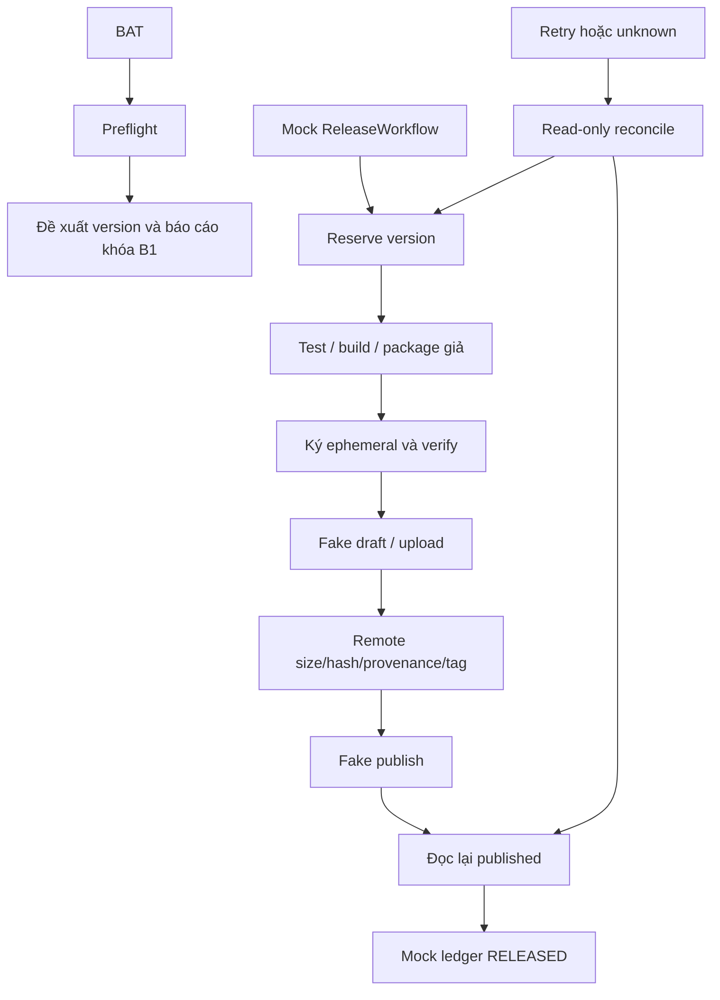

# TransComic — One-click Release & Update B1

Ngày thực hiện: 14/10/2026. **B1 READY FOR B2** ở mức mã và mock: hai full suite liên tiếp cùng mã đạt **600 passed, 1 skipped** mỗi lượt, GUI Windows ba DPR đạt. Bản ứng dụng vẫn **0.1.0**, đề xuất PATCH **0.1.1**. Chưa được phép build/cài/phát hành production.

## Kiến trúc

Một `release_transcomic.bat` gọi `scripts/release_transcomic.py`, chỉ preflight. `transcomic/release.py` điều phối concrete fake adapters, không HTTP client/shell/launcher; không env/CLI mở khóa production. Giữ guard Stage A trong spec, ISS, signing, install. Updater dùng lại metadata/service/install/backup/UpdatePanel; thêm helper/signing/compatibility contracts, không subsystem thứ hai.



Không sửa translation/scheduler/provider/storage/validator/export/skin; không tab/sidebar mới hoặc giảm diện tích editor. [Scope SHA](../artifacts/release-stage-b1/scope.json).

## Môi trường thực đo

[Preflight mới](../artifacts/release-stage-b1/preflight.json):

| Thành phần | Kết quả |
|---|---|
| Python | 3.13.14, Windows AMD64 64 bit; chưa venv |
| gh | 2.102.0, `C:\Program Files\GitHub CLI\gh.exe`, PATH |
| gh auth / repo | login và public repo đúng được xác nhận; không log auth/token |
| Git | chưa phát hiện PATH, vị trí phổ biến, registry uninstall |
| Inno Setup 6 | chưa phát hiện PATH, vị trí phổ biến, registry uninstall |
| SignTool | chưa phát hiện PATH/Windows Kits x64 |
| PyInstaller | 6.22.0, chỉ đọc metadata, không chạy build |
| PySide6 / cryptography / pytest | 6.11.1 / 50.0.2 / 9.1.1 |
| Lock | `requirements-release.lock`: exact pins môi trường đã thử; chưa wheel hashes/máy sạch |

Discovery phân biệt PATH/INSTALLED_OUTSIDE_PATH. “Chưa phát hiện” không chứng minh không có bản portable trong thư mục tùy chỉnh khác. Không tìm thấy source Git/origin/HEAD đã xác minh; không init repo. Không cài phần mềm/đổi PATH.

Lệnh dành cho người dùng/B2 **sau khi cho phép**, chưa chạy:

```powershell
winget install --id Git.Git -e --interactive
winget install --id JRSoftware.InnoSetup -e -s winget -i
python -m venv .venv
.venv\Scripts\python -m pip install -r requirements-release.lock
```

Kiểm tra/chọn Inno **6.x** trước khi dùng; lệnh vendor tại [Inno Downloads](https://jrsoftware.org/isdl.php), bản cũ tại [Old Downloads](https://jrsoftware.org/isdl-old.php). SignTool thuộc [Windows SDK](https://learn.microsoft.com/en-us/windows/win32/seccrypto/signtool). Không yêu cầu cài lại gh/PyInstaller đã có; chưa kiểm chứng cài lệnh trên.

## BAT và version

```powershell
.\release_transcomic.bat
.\release_transcomic.bat --bump minor
.\release_transcomic.bat --bump major
.\release_transcomic.bat --bump 0.2.1
```

Luôn hiện `STAGE B1 — PREFLIGHT ONLY`, `Không build hoặc phát hành trong giai đoạn này`. Chỉ discovery/gh read-only/preflight report; không sửa version hoặc release ledger production. Không chạy full suite mỗi lần BAT; suite chạy riêng trong đợt này. `--publish` bị từ chối. Test cwd ngoài repo/có khoảng trắng; ưu tiên `.venv` nếu có.

Nguồn duy nhất `transcomic/version.py`, setuptools dynamic version. `version_outputs` sinh installer filename/tag/name/ISS include/EXE tuple từ cùng version. Spec dựng VSVersionInfo từ VERSION; test parse resource không build. ISS include chỉ sinh khi B2 được phép. Template chưa có version/size/hash/key production dùng được. PATCH0.1.1/MINOR0.2.0/MAJOR1.0.0/explicit stable có tests; không tự chuyển thành1.0.0.

## Journal, phục hồi và provenance

MockLedger ghi `.part`/flush/fsync/replace trong thư mục test; reserve version trước action. PENDING → PUBLISH_PENDING → RELEASED, cuối chỉ sau đọc lại published và verify. Lỗi test/build/package/sign/verify/upload/publish giữ version; retry chọn MAJOR vẫn resume version cũ. Journal invalid dừng, không bỏ qua để bump.

Draft có journal tương ứng giữ version, upload tiếp asset giống bytes; asset xung đột dừng, không overwrite/delete. Existing tag phải trỏ đúng distribution SHA; source SHA riêng. Publish unknown hoặc remote thành công/local save lỗi: read-only reconcile rồi final save, không publish lại. Remote read fail/release mất/tag/hash/provenance đổi: dừng. Release tiếp theo chỉ reserve PATCH sau publish đã xác minh, source version bằng version vừa published và source commit mới. Mock không sửa source version thật.

Distribution repository cố định `Thnhphngz/TransComic-Releases`. Source repository/exact40hex source SHA/clean checkout phải xác minh riêng tại B2. Distribution commit/tag không phải commit build app. Manifest/remote fake chứa source_repository/source_commit/distribution_commit; test mismatch. SHA/repo fixture là giả; chưa xác minh source repo thật, không tạo/công khai/push source.

Fake remote đọc bytes đối chiếu đủ ba assets/tên/size/hash/provenance/tag trước publish, sau publish kiểm tra lại. B2 adapter cần verify download/API digest thật với size limit. [GitHub Releases API](https://docs.github.com/en/rest/releases/releases?apiVersion=latest) cung cấp published/draft/asset digest; target_commitish distribution không thay source provenance.

## Spec và Installer

Spec giữ RuntimeError lock đầu file. Absolute entry/pathex, đường dẫn có dấu cách. Datas chỉ SVG app; plugins families platforms/imageformats/styles, kiểm tra qwindows.dll. Hidden imports docx/QtSvg/QtNetwork/charset_normalizer. ICO từ SVG logo hiện có qua Qt; EXE version resource parse được. Exclude tests/pytest/scripts/tkinter; không root data glob, user DB/Word/log/cache/credentials/private keys. Static checks resource/dependency/lock pin mismatch; chưa build để xác minh dependency closure thực tế. [PyInstaller version/icon](https://pyinstaller.org/en/stable/usage.html?highlight=add-data).

ISS giữ `#error Stage A locked`, stable AppId `{CB58C770-47B7-42DC-A2CA-409DDF456487}` và UsePreviousAppDir=yes. Per-user LOCALAPPDATA Programs, Win10/11 x64, PrivilegesRequired=lowest, Start Menu/Desktop optional mặc định unchecked. Icon/version thống nhất, không UninstallDelete data. CloseApplications/RestartApplications=no; không kill/UAC bypass. Postinstall restart chỉ interactive/skipifsilent; silent helper tương lai kiểm tra version trước restart. [Inno lowest](https://jrsoftware.org/ishelp/topic_setup_privilegesrequired.htm) là non-admin mode, không tự giải quyết installer admin cũ.

Chưa có proof installer cũ ngoài config Stage A. B2 phải thử old AppId/location/install/upgrade/uninstall trên Windows sạch, lock/antivirus/policy; static config không thay installer tests.

## Chữ ký và manifest

sign_payload ký canonical JSON Ed25519, caller giữ key. TrustPolicy pin ID/overlap rotation/revocation, tests ephemeral memory keys. production_sign khóa; **PRODUCTION_KEYS={}** giữ nguyên; không tin key từ manifest/remote/env.

Format2 dùng signed_at UTC của signer; GitHub published_at chỉ chứng minh release đã publish, không bắt hai thời điểm bằng nhau. Vẫn bound app/version/tag/repo/platform/size/hash/minimum updater/signature. Format1 tiếp tục quy tắc Stage A cũ. Tests format2 khác server time/malformed/unknown/tamper. B2 cần thử protocol trên Draft thật được cấp quyền.

Kế hoạch production, chưa thực hiện:

1. Duyệt owner/key ID/nơi ký trước tạo key.
2. PKCS8 encrypted, password qua prompt/secret store, ngoài repo/artifacts; ACL chỉ signer/developer. Không BAT/env/log/plaintext fallback.
3. Backup encrypted offline riêng, thử restore cô lập; không upload private key public hoặc package EXE.
4. Pin public key bằng reviewed source; phát hành client có old+new trước khi chuyển chỉ ký new.
5. Thu hồi key bằng reviewed pinned policy/source change; compromise: dừng publish/install, revoke certificate nếu liên quan và chuyển trust anchor qua kênh đã tin. Client offline cũ không biết revocation ngay.
6. B2 cần encrypted loader/ACL verification và real signer; B1 không tạo production key, không đánh đồng ephemeral với production.

Authenticode cần cert/signing provider + SignTool SHA256/RFC3161 và verify `/pa`; hash manifest tính **sau** Authenticode vì bytes đổi. Chưa có cert cấu hình/xác minh, không export private cert. Ed25519 không thay Windows publisher/SmartScreen trust; không cam kết hết cảnh báo. [Microsoft guidance](https://learn.microsoft.com/en-us/windows/apps/develop/smart-app-control/code-signing-for-smart-app-control).

## Helper và UI

ExternalHelper kế thừa InstallMachine, chỉ concrete FakeProcess/FakeEnvironment/FakeInstaller. ProcessIdentity PID+creation identity, PID reuse chặn. Snapshot cần app closed/process exited/Safe Exit verified; translation/pause/inflight/editor/SQLite transaction/unknown chặn, window hide không đủ. Reverify trước mock install; tamper/file lock/elevation/UAC canceled/installer failure/power loss/version mismatch/restart failure không COMPLETED. Không restart khi install/version chưa xác minh; simulated=true/actual_install=false.

UpdatePanel.simulate_helper dùng đúng downloaded_path/service verifier, chỉ testing service; không activation button/cài thật. UI ghi mô phỏng, không nói app đã nâng cấp. Shutdown chặn signal worker đến Qt owner đã xóa, không đợi HTTP trên GUI thread.

B2 helper riêng phải giữ original Windows process handle + creation time, đợi exit thật; executable/restart path cố định từ install location đã xác minh, không metadata arbitrary path. Safe Exit flush/close DB trước handoff; không kill/overwrite EXE đang chạy. Restricted download directory + reverify/TOCTOU/file handle cần Windows tests thật. B1 không có launcher/helper EXE và không coi FakeProcess là process handle thật.

## Dữ liệu và rollback

Không sửa schema/chạm user DB. Reuse SQLite Backup API; temporary WAL committed history/opaque blob/integrity/transaction migration failure/schema range tests. Không export DPAPI, không copy riêng DB đang WAL writes. DB mới hơn app hoặc ngoài supported range bị chặn.

Chưa migration: previous binary chỉ khi schema compatible. Đã commit migration: manual recovery từ verified backup, có thể mất thay đổi sau backup; không tự restore DB thật, không tuyên bố production schema rollback hoàn chỉnh. Installer failure/power loss không xác nhận installed version hoặc replay unknown translations.

## Kiểm thử và GUI

Kết quả cuối tại [acceptance.json](../artifacts/release-stage-b1/acceptance.json). [Full1 log](../artifacts/release-stage-b1/regression-1.log)/[XML1](../artifacts/release-stage-b1/regression-1.xml), [Full2 log](../artifacts/release-stage-b1/regression-2.log)/[XML2](../artifacts/release-stage-b1/regression-2.xml); [snapshot mã](../artifacts/release-stage-b1/regression-source.json). Full1 mới: **600 passed,1 skipped,174.35s**; full2: **600 passed,1 skipped,173.39s**. Hai lượt cùng source/tests SHA, không native Qt crash trong các lượt này. Không dùng kết quả534 của Stability làm proof B1. Không xóa test cũ, chỉ cập nhật path preflight BAT từ StageA sangB1. Skip API ledger cũ giữ nguyên, không reset.

GUI entry point thật run_transcomic.py/QtWindows/LOCALAPPDATA tạm/HTTP guard. DPR **1.0/1.25/1.5**, Light/Dark,900×580/1200×720/maximized, available/progress/cancel/verify success/failure/Safe Exit block/helper mock success/tamper block. Editor/workspace/chips/SkySwitch giữ nguyên. [100%](../artifacts/release-stage-b1/windows/0.8/report.json), [125%](../artifacts/release-stage-b1/windows/1/report.json), [150%](../artifacts/release-stage-b1/windows/1.2/report.json); ảnh cùng thư mục. SystemDPI125%, scale0.8/1/1.2 tạo DPR đo1/1.25/1.5.

## Trước B2

Cần quyền riêng build/ISCC/production key/cert/installer VM tests/GitHub Draft-upload-tag-publish/cài update thật. Chuẩn bị Git/Inno6/SDK nếu cần, venv/hash-locked wheels/máy sạch; xác minh source repo/clean SHA/distribution tag policy. Chốt pin/signing/rotation/revocation; implement/review production adapters/helper OS handles/durable journal locking/recovery, cùng BAT/contracts; không chỉ đổi biến để bỏ guard. Thử actual build/resources/version/installer compatibility/upgrade/uninstall/Safe Exit/UAC/restart/crash/remoteAPI. Một nút không bảo đảm mọi Windows: policy/SmartScreen/Defender/UAC/admin install cũ/lock có thể cần người dùng xử lý, không bypass.

## Báo cáo 25 mục

1. Release script: preflight thật, workflow đầy đủ fake; production khóa.
2. BAT: discovery/gh readonly/version proposal/report; không version/publish ledger thật.
3. 0.1.0 → PATCH0.1.1.
4. PATCH/MINOR/MAJOR/explicit có tests.
5. Reserve/resume cùng version, bump tiếp sau confirmed publish/source version mới.
6. Repo distribution đúng/auth/public xác nhận readonly.
7. Source repo/SHA riêng, source identity thật chưa xác minh.
8. Python/gh/PyInstaller có; Git/Inno6/SignTool chưa phát hiện; chưa venv/wheel hashes.
9. Spec/plugins/icon/resources/version và ISS per-user stableAppId chuẩn bị tĩnh.
10. Allowlist/sensitive scan/tests; không user DB/keys/docs/log/cache/private signing key.
11. Ed25519 interface/ephemeral tests/rotation/revocation/encrypted-key plan.
12. Production public key chưa chốt, map trống.
13. Authenticode/cert vẫn cần B2, Ed25519 không thay Windows publisher.
14. Helper fake process identity/Safe Exit/reverify/install/version/restart; real launcher chưa kích hoạt.
15. Downloader/cache/hash/signature tests còn chạy; format2 sửa prepublish timestamp contract.
16. Temporary SQLite WAL/blob/integrity/migration failure/schema/rollback limitations tests.
17. Full1:600 pass1skip/174.35s; full2:600 pass1skip/173.39s, cùng mã, không crash.
18. GUIWindowsDPR1/1.25/1.5 Light/Dark đạt các scenarios trong report.
19. Không Kira/Gemini thật/reset ledger.
20. Không build EXE/PyInstaller.
21. Không ISCC/installer/helper process thật/cài trên dev.
22. Không tag/push/Draft/upload/publish; chỉ readonly preflight.
23. Thiếu B2: môi trường/provenance/trust/cert/real adapters/build/installer/API tests được cấp quyền.
24. Một BAT/một nút là contract đã mô phỏng; chưa bảo đảm mọi Windows, không bypass.
25. **B1 READY FOR B2**: hai full suite mới liên tiếp + ba GUI DPR + scope SHA đạt. Chỉ mã/mock sẵn sàng; các prerequisites B2 nêu trên chưa giải quyết, production vẫn khóa/chưa được phép.
