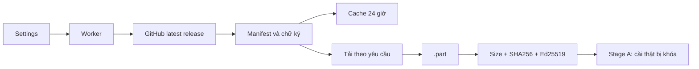

# TransComic — Updater Giai đoạn A

Giai đoạn A chuẩn bị mã và kiểm thử mô phỏng: **không build, tạo tag, upload, publish hoặc chạy installer**. Version `0.1.0` từ pyproject cũ được giữ nguyên. Repo public phân phối: `Thnhphngz/TransComic-Releases`, độc lập repo mã nguồn.

## 1. Kiến trúc

`transcomic/version.py` là nguồn version duy nhất; setuptools dynamic metadata đọc tại đây. `update/metadata.py` xử lý SemVer, JSON không khóa trùng, danh tính và Ed25519. `update/service.py` check/cache/download chạy nền; `update/install.py` state machine và fake adapter, không launcher thật. `update/backup.py` backup SQLite thử. `ui/update_panel.py` card Cài đặt, V3 components, worker gửi queued Qt signals, không network trên GUI thread.



## 2. Repo và version

GET `https://api.github.com/repos/Thnhphngz/TransComic-Releases/releases/latest`, không token/auth. Stable chỉ nhận tag `vMAJOR.MINOR.PATCH`, không draft/prerelease. SemVer so sánh số, xử lý prerelease/build precedence. Version app/manifest/installer/tag phải khớp. BAT đề xuất patch/minor/major/version chỉ định cao hơn, không sửa version thật.

## 3. State machine và Safe Exit

IDLE, CHECKING, UP_TO_DATE, UPDATE_AVAILABLE, DOWNLOADING, VERIFYING, READY_TO_INSTALL, WAITING_FOR_SAFE_EXIT, INSTALLING, INSTALL_FAILED, COMPLETED, CANCELLED, ERROR. FakeInstaller chỉ `.testdata`, kết quả `simulated=True`; COMPLETED chỉ mô phỏng. UI báo “Stage A không chạy bộ cài”, không tuyên bố app đã nâng cấp.

`SafetySnapshot` phải không dịch/pause/in-flight/transaction/editor và đủ app closed + process exited + safe exit verified. `window_safety()` chỉ đọc status hiện có, không xác nhận process exit từ việc cửa sổ biến mất. Không kill process. Lỗi Safe Exit 900ms V3 chưa được sửa. `install()` luôn từ chối; không có env/CLI/UI override hoặc production adapter.

## 4. GitHub/cache

200 parse bounded metadata; 304 chỉ dùng cache hợp lệ; 404 “Chưa có bản cập nhật được phát hành”; 403/429 cooldown ít nhất 24 giờ. Timeout/mạng/JSON lỗi không chặn app. Metadata latest ≤1 MiB, manifest ≤128 KiB. Không lộ response/token/URL nhạy cảm trong lỗi.

Auto check bật mặc định, bắt đầu sau 2,5 giây ở entry point; kiểm tra cache trong worker, tối đa một lần mạng/24 giờ kể cả lần lỗi. Thủ công bỏ qua khoảng 24 giờ nhưng vẫn tôn trọng cooldown. Tắt auto không gửi request mới. Trì hoãn auto khi scheduler hoặc worker nhập/xuất đang chạy. Không auto download/install, không modal, không giành focus. Cache ở `%LOCALAPPDATA%\TransComic\Updates\check-cache.json`.

## 5. Manifest/asset

Asset `transcomic-update.json` có envelope `{payload, signature}`. Payload:

| Trường | Quy tắc |
|---|---|
| app_id | `TransComic.Desktop` |
| version / release_tag | stable / `v` + version |
| channel / os / architecture | `stable` / `windows` / `x64` |
| installer_filename | `TransComic-Setup-{version}-windows-x64.exe` |
| installer_size / sha256 | số nguyên dương ≤512 MiB / 64 hex thường |
| release_url / published_at | khớp chính release đang kiểm tra |
| minimum_updater_version | không lớn hơn updater hiện tại |
| minimum_windows | `10` cho Windows 10/11 |

Asset tên duy nhất, state uploaded, URL repo/tag/name và size chính xác. Không đọc download URL trong changelog. Production không nhận `.testdata`; test dùng tùy chọn DI riêng và khóa ephemeral, không tạo EXE giả.

## 6. Tải/xác minh

Chỉ HTTPS GitHub đúng repo và redirect tới `release-assets.githubusercontent.com`, tối đa 5 redirect. Chặn URL auth/port lạ/fragment, host tùy ý, traversal, extension/platform sai. Tải `%LOCALAPPDATA%\TransComic\Updates`, không vào source/DB; `.part` random mở exclusive, size/hash/signature kiểm tra trước rename. Hủy/lỗi dọn phần tải, không xóa dữ liệu. File có sẵn chỉ reuse sau reverify. Không retry vô hạn hoặc chạy file tải.

## 7. Ký số

SHA-256 chỉ bảo đảm tính toàn vẹn so checksum, **không tự bảo đảm danh tính publisher**. Interface Ed25519 ký canonical JSON payload (UTF-8, sort keys, separators `,`/`:`, ensure_ascii=False, không NaN). Signature gồm algorithm, key_id, base64 value. Public key phải pin trong app; `PRODUCTION_KEYS` hiện trống. Thiếu khóa/chữ ký báo `NOT_READY_FOR_PRODUCTION_INSTALL`, tải/cài disabled; chữ ký sai bị từ chối. Không tự tạo khóa production hoặc tin key từ release/env. Stage B chốt khóa + rotation/revocation hoặc triển khai Authenticode gắn publisher đã xác nhận.

## 8. Cài đặt tương lai

Helper độc lập phải đợi process handle, reverify bộ cài sau thoát, chờ DB an toàn, chạy installer, kiểm tra version cài và chỉ mở lại khi thành công. Hiện chỉ fake process/data adapter; chưa có đường cài thật. Không coi cửa sổ đóng là bằng chứng Safe Exit.

## 9. Dữ liệu/backup/rollback

SQLite `%LOCALAPPDATA%\TransComic\transcomic.sqlite3`; DPAPI blob nằm trong DB, không fallback plaintext. Updater chỉ thêm setting `update_auto_check`; không đổi schema, key, history, theme/layout/target policy. Installer giữ AppId cũ, program ở `%LOCALAPPDATA%\Programs\TransComic`, không UninstallDelete dữ liệu, không tự close/kill/restart. Không di chuyển dữ liệu thật.

Helper backup dùng SQLite Backup API và integrity check; test dữ liệu committed trong WAL và DPAPI blob fixture. Không copy riêng file DB đang ghi. Trước migration thật cần backup, migration journal, version tương thích DB/app và rollback có kiểm thử. **Chưa tuyên bố rollback schema migration production an toàn**; A không có migration thật.

## 10. BAT/offline test

```powershell
release_transcomic.bat
release_transcomic.bat --bump minor
python -m pytest -q
$env:QT_SCALE_FACTOR='1'
python scripts/updater_gui_smoke.py
```

BAT từ working directory bất kỳ, ưu tiên `.venv`, đường dẫn có khoảng trắng. Chỉ discovery/preflight và báo cáo `artifacts/updater-stage-a/preflight.json`, không tự cài tool. `gh` login và target public đã xác nhận; Git/ISCC chưa thấy, Python không ở venv, PyInstaller có sẵn. Offline tests dùng MockTransport, GUI smoke Windows entry point chặn HTTP thật và dùng LOCALAPPDATA tạm. Không dùng số test V3 cũ làm số test A.

## 11. Điều chưa được phép và chuẩn bị B

Build/tag/upload/publish/cài thật bị khóa bằng mã riêng, spec `raise RuntimeError`, ISS `#error`. Stage B phải được cấp quyền và thay đổi source riêng: Git/ISCC/dependency lock, khóa/chứng thư ký, version/commit/tag chính xác, build/installer máy sạch, nâng cấp/uninstall, remote asset verify, recovery/rollback, helper Safe Exit. Không cho biến môi trường hoặc `--publish` bật ngay ở A.

Windows SmartScreen, Defender, chính sách doanh nghiệp, quyền admin của bản cài cũ, file lock hoặc antivirus có thể cần xác nhận. Không tự vượt qua cảnh báo. Một BAT/một nút là mục tiêu B, chưa bảo đảm trên mọi máy.

## 12. Kết quả và báo cáo 25 mục

**Trạng thái bàn giao:** mã Stage A và kiểm thử mô phỏng đã triển khai; **chưa chốt nghiệm thu để chuyển B**, chưa sẵn sàng production. [Tổng hợp bằng chứng](../artifacts/updater-stage-a/acceptance.json). Các lỗi hồi quy dưới đây vẫn là blocker, không bị bỏ qua vì release đang khóa.

Lượt hồi quy A đầu tiên mới chạy: **528 đạt, 0 lỗi, 1 skip**, 181,04 giây, [log](../artifacts/updater-stage-a/regression.log), [XML](../artifacts/updater-stage-a/regression.xml). Đây là kết quả mới, không sao chép số V3. Sau đó thêm helper backup WAL và một test.

Lượt toàn bộ sau đó **bị native crash**, không có XML hoàn tất: `ui/editing.py:126`, `QListWidget.clear()` của Tìm/Thay. [Log crash](../artifacts/updater-stage-a/regression-final.log). Vị trí này cũng có trong các log V3 trước A, nhưng chưa chứng minh nguyên nhân duy nhất hoặc rằng updater không thể ảnh hưởng timing; không tuyên bố crash đã được sửa.

Chạy chẩn đoán đủ 27 file riêng tiến trình: **526 test có XML, 523 đạt, 2 lỗi, 1 skip**; một file Tìm/Thay lại crash. [Báo cáo từng file](../artifacts/updater-stage-a/isolated/report.json), [XML](../artifacts/updater-stage-a/isolated/all.xml). Bốn test của file đó chạy tiếp **mỗi test một process**, cả **4/4 đạt**, [báo cáo](../artifacts/updater-stage-a/search-cases/report.json). Tổng phủ đủ **530 test độc lập: 527 đạt, 2 lỗi, 1 skip**; đây là kết quả chẩn đoán có cách ly, **không phải hồi quy một process xanh**.

Hai lỗi còn lại:

- `test_unknown_reset_or_exhaustion_pauses_without_hammering[envelope0-headers0]`: `scheduler.intervention_reason` chưa đặt tại thời điểm assert. [Log](../artifacts/updater-stage-a/isolated/test_final_workflow.log). Scheduler/429 code giữ nguyên, không sửa trong A.
- `test_cancel_and_safe_exit_do_not_resend_inflight`: chưa đóng cửa sổ trong 900ms. [Log](../artifacts/updater-stage-a/isolated/test_window_lifecycle.log). Không nới deadline hay sửa backend/test này.

**91/91 test updater mới đạt** (86 unit/integration/security/release/backup, 5 GUI), và **22/22 V3 GUI tests đạt** ở lượt chẩn đoán. Skip là test DOCX có ledger hết hạn mức kiểm thử từ đợt trước; không reset ledger. Tất cả lỗi/crash được giữ làm blocker Giai đoạn B, không coi cài production đã sẵn sàng.

Smoke entry point `run_transcomic.py`, Qt platform Windows, DPR thực đo **1,0 / 1,25 / 1,5**. Mỗi DPR kiểm tra Light/Dark, 900×580, 1200×720, maximized, sidebar thu gọn, no release, changelog, progress/cancel, verified simulation, workspace/chips trống, signal chạy ngoài GUI thread. Fixture tải `.testdata`, không EXE giả. HTTP thật và installer process đều **0**. [100%](../artifacts/updater-stage-a/windows/0.8/report.json), [125%](../artifacts/updater-stage-a/windows/1/report.json), [150%](../artifacts/updater-stage-a/windows/1.2/report.json). [Ảnh Light](../artifacts/updater-stage-a/windows/1/update-full-False.png), [Dark](../artifacts/updater-stage-a/windows/1/update-full-True.png), [tiến độ](../artifacts/updater-stage-a/windows/1/download-progress.png), [hủy](../artifacts/updater-stage-a/windows/1/download-cancelled.png).

### Báo cáo 25 mục

1. **File:** thêm `release_transcomic.bat`, `scripts/release_transcomic.py`, `transcomic/version.py`, package `transcomic/update` (metadata/service/install/backup), `ui/update_panel.py`, `installer/release-manifest.template.json`, hai test updater, smoke/diagnostic scripts, hai tài liệu. Chỉnh pyproject, spec, ISS, app/main UI, .gitignore và README; giữ code dịch.
2. **Script:** BAT tìm Python và gọi script bằng đường dẫn tuyệt đối, dù cwd khác/có khoảng trắng; chỉ lệnh discovery/read-only được chạy; báo cáo `preflight.json`, bump chỉ đề xuất.
3. **Khóa A:** không có implementation build/publish/install production hoặc flag/env mở khóa; read-only command whitelist và guard spec/ISS. Full môi trường giả vẫn khóa; `--publish` bị argparse từ chối.
4. **Gh/repo:** gh thật đã login `Thnhphngz`, repo public `Thnhphngz/TransComic-Releases` xác nhận; status raw không đưa vào báo cáo. Git/ISCC chưa thấy, không tự cài.
5. **Version:** `transcomic/version.py`, giữ `0.1.0`, setuptools dynamic; ISS include từ nguồn đó phải sinh ở B. Không bump version thật.
6. **Endpoint:** GET GitHub releases/latest nêu ở trên; client người dùng không token/Git/gh.
7. **Repo chưa release:** 404 có trạng thái bình thường, test mock và GUI đều kiểm tra; preflight gh list chưa có tag release.
8. **24 giờ:** cache timestamp/ETag gồm lần lỗi; startup trì hoãn/worker, auto defer đang dịch; manual có cooldown rate limit, không auto tải/cài.
9. **Downloader:** byte/total/tốc độ/progress, stream background, timeout, cancel, no retry vô hạn; `.part` được dọn khi hủy/lỗi.
10. **SHA:** streaming file, đọc lại `hashlib.file_digest` và so size/hash signed payload trước rename/reuse; hash/size sai chặn.
11. **Signature:** Ed25519 interface verify thật, ephemeral keys trong tests; production keys trống => NOT_READY. Stage B phải chốt trust policy trước cài thật; checksum không thay chữ ký.
12. **Asset:** repo/tag/name/URL/state/size/platform/architecture, JSON duplicate, redirect HTTPS allowlist và stable SemVer; không URL từ changelog. Không phải antivirus scan và không bảo đảm tuyệt đối mọi file không độc hại.
13. **Installer mock:** concrete FakeInstaller không subprocess, chỉ data fixture; simulated flag, success/failure/cancel/safety barriers; real install luôn chặn.
14. **SQLite/DPAPI:** user DB tách program, không migration/xóa/đổi key/history. Backup API + WAL test giữ committed history và opaque encrypted blob fixture; chưa test production migration rollback.
15. **UI:** Cài đặt giữ V3, thêm card và scroll của trang Cài đặt, không giảm editor; một SkySwitch, chips reset fresh startup, không rebuild UI nền tảng.
16. **Windows:** cả ba DPR thật đạt; ảnh và JSON links bên trên. Không chỉ đọc QSS.
17. **Tests:** số lượt đầu và cuối ghi riêng; unit/integration mới gồm SemVer/metadata/cache/download/security/release/backup; Qt GUI mới và 22 V3 tests vẫn được chạy, không xóa test cũ.
18. **Safe Exit:** test 900ms đạt ở lượt A đầu và thất bại ở lượt chẩn đoán cuối; không sửa test/backend, chưa đủ bằng chứng process exit cho cài production. Còn crash Tìm/Thay và assertion scheduler429 nêu trên.
19. **Backend:** SHA-256 20 file top-level so đầu A; chỉ `app.py` thay một dòng start auto check. Providers/Gemini/translation/storage/status/language/validators/export không đổi. [Đối chiếu](../artifacts/updater-stage-a/scope-verification.json).
20. **Kira/Gemini:** 0 request thật; tests dùng mock, GUI guard HTTP, DB/LOCALAPPDATA tạm. Gh đọc metadata public được phép.
21. **EXE:** không build, không gọi PyInstaller/ISCC. Chỉ cấu hình tĩnh có guard.
22. **GitHub write:** không tag/push/create/upload/publish; chỉ gh auth/repo view/release list read-only.
23. **Thiếu B:** Git/ISCC/venv toolchain, khóa ký production, source/distribution commit, build/artifact/installer VM tests, helper process wait/Safe Exit, remote verify/recovery/migration policy và quyền B.
24. **One file:** sau code activation B, cùng BAT điều phối preflight→test→build→package→verify→draft→upload→remote verify→publish/report; chưa thực hiện các bước ghi thật ở A.
25. **One-click người dùng:** mục tiêu một nút tải/cài sau B, chưa cam kết mọi máy; SmartScreen/UAC/Defender, policy doanh nghiệp, bản cài admin cũ và file lock có thể cần xác nhận, không tự vượt qua.
